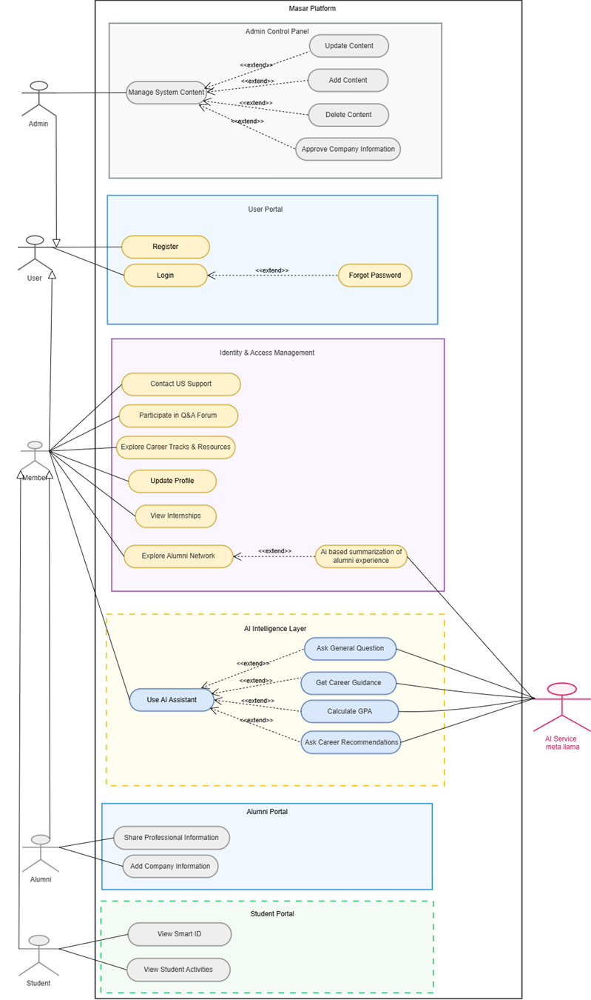
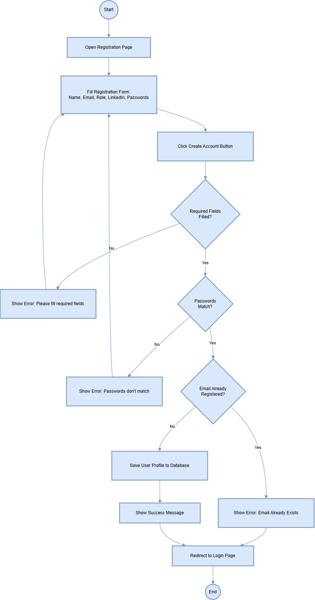
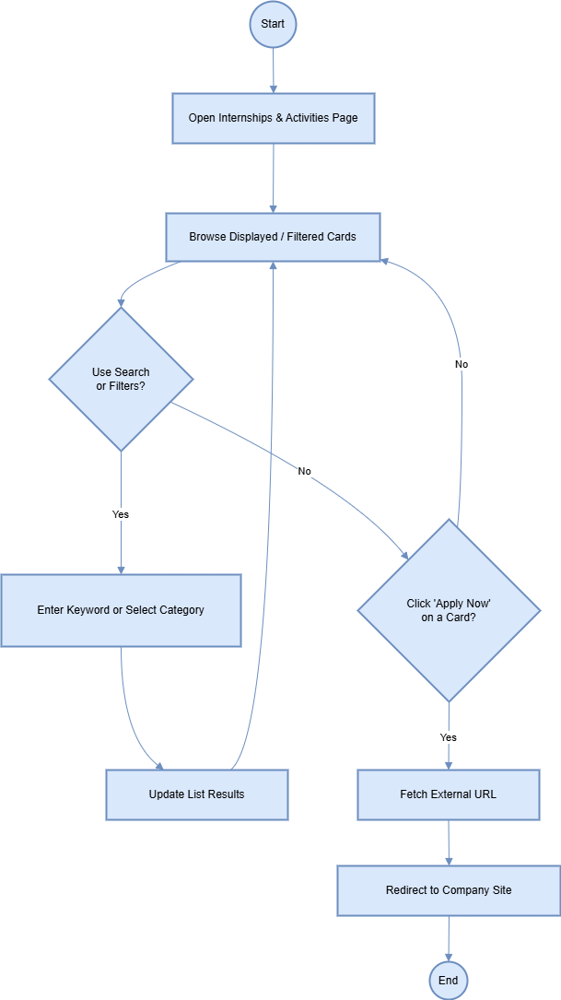
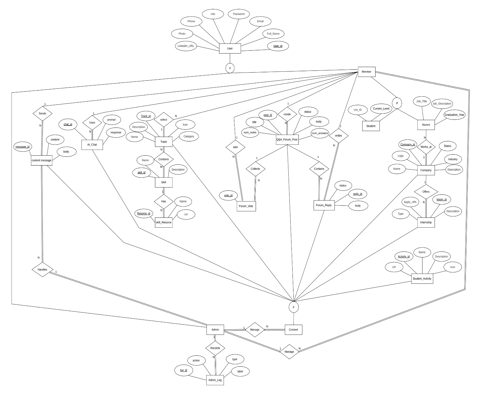
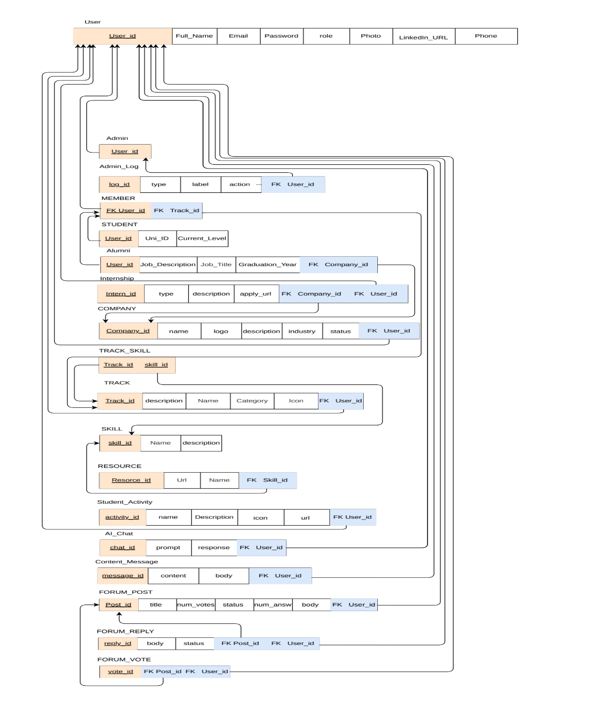
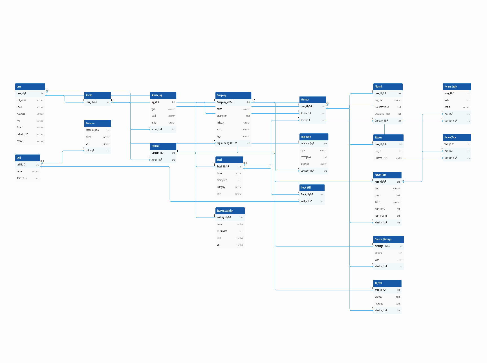
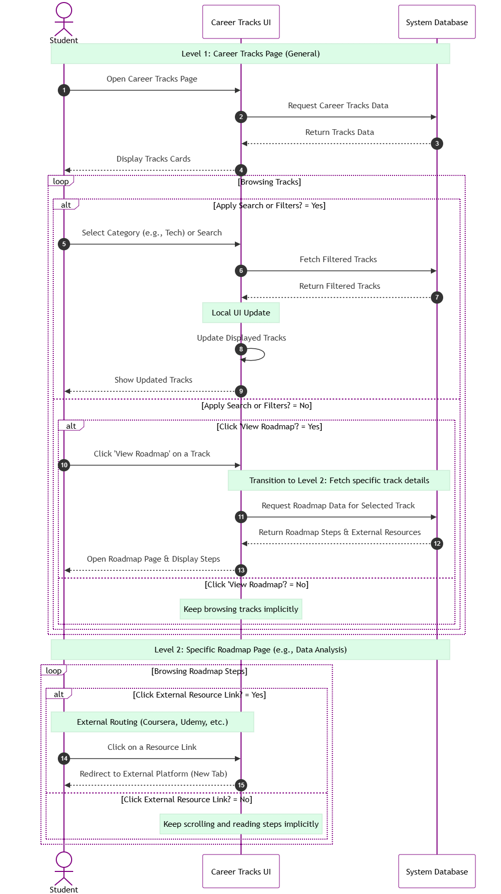
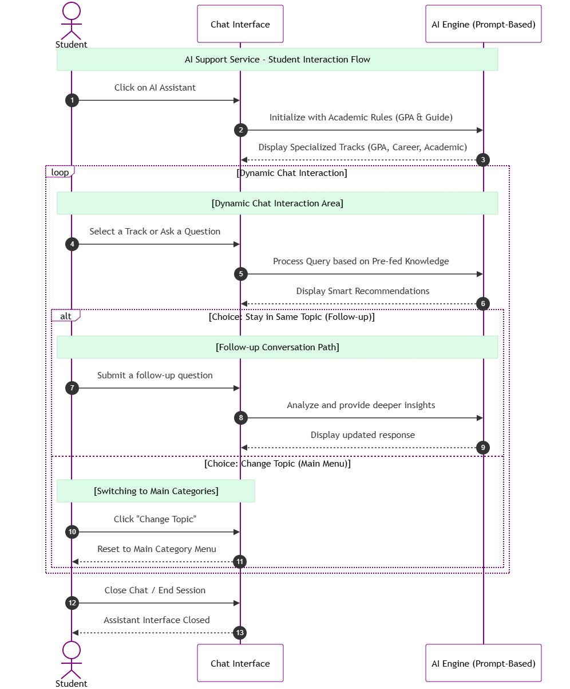

# MASAR — BIS Career Guidance Platform
### Graduation project | System Analysis & Design Case Study (2025–2026)

**Focus:** Requirements Gathering · Functional & Non-Functional Requirements · Use Cases · Activity Diagrams · ERD · Database Mapping · Class Diagrams · Sequence Diagrams

MASAR is a team graduation project exploring a centralized career guidance platform for Business Information Systems (BIS) students and alumni. The project addresses scattered career resources, internship opportunities, and alumni connections through one web-based platform.

> **My contribution:** I worked on **System Analysis** as one of two system analysts in a six-member team. This repository focuses on the analysis and design deliverables documented in **Chapter 3 (pp. 56–77)** and **Chapter 4 (pp. 78–95)** of our graduation report. I am **not** claiming sole ownership of the website, UI implementation, or back-end code.

## The problem

BIS students often rely on disconnected platforms for career roadmaps, training resources, internships, and access to alumni. The project aimed to bring these resources together and support more informed academic and career decisions.

## Users and system scope

The analysis identifies **User, Member, Student, Alumni, and Admin** roles, along with an external AI service in the use-case model. The documented system covers:

- Account registration, authentication, and profile management
- Career tracks, learning roadmaps, and academic resources
- Internship opportunities and student activities
- Alumni networking, company information, and a Q&A forum
- AI-assisted guidance and GPA-related features
- Administrative content and user management

*These describe the documented requirements and system scope, not a claim that every proposed feature was deployed.*

## System Analysis — Chapter 3

The report documents an Agile development approach and requirements gathering through **informal interviews/discussions, observation, document research, and team brainstorming**. Requirements were classified as:

- **Functional:** The actions users and administrators need to perform.
- **Non-functional:** Security, usability, reliability, availability, scalability, maintainability, performance, and browser compatibility.

The use-case and activity diagrams show how system roles interact with workflows, including registration, login, profile updates, opportunities, the community forum, and AI-assisted features.

### Use-case diagram


### Create account — activity diagram


### Internship workflow — activity diagram


## System Design — Chapter 4

The design chapter documents the **Entity–Relationship Diagram (ERD)**, **database mapping**, **class diagram**, and **sequence diagrams** describing interactions between system components.

### Database ERD


### Database mapping


### Class diagram


### Explore career tracks — sequence diagram


### AI services — sequence diagram


## My system-analysis experience

This graduation project gave me practical experience in documenting user needs, translating them into requirements, identifying user roles, representing business processes visually, and connecting system behavior to database and component designs. I worked within a cross-functional team that also included business, front-end, and back-end roles.

## Repository contents

```text
MASAR-System-Analysis/
├── README.md
├── diagrams/
│   ├── 01-use-case-diagram.png
│   ├── 02-account-registration-activity.png
│   ├── 03-internship-activity.png
│   ├── 04-database-erd.png
│   ├── 05-database-mapping.png
│   ├── 06-class-diagram.png
│   ├── 07-career-tracks-sequence.png
│   └── 08-ai-services-sequence.png
└── docs/
    └── MASAR-Chapters-3-and-4.pdf
```

[**Read the original System Analysis & System Design chapters (PDF)**](docs/MASAR-Chapters-3-and-4.pdf)

## Project attribution & notes

- **Project:** MASAR — BIS Career Guidance Platform (2025–2026)
- **Type:** Team graduation project (six members)
- **My role:** System Analysis, shared with another team member
- **Evidence:** Excerpts and diagrams from the team-authored graduation report, Chapters 3 and 4
- **Source code:** Not included here. This is a **system analysis and design case study**, not a runnable application.
- **Publishing:** Only share this excerpt and diagrams publicly if the team/university permits publication of the project documentation.

---
[Peter Nabil](https://github.com/Peternab8) · [LinkedIn](https://www.linkedin.com/in/peter-nabilg/)
